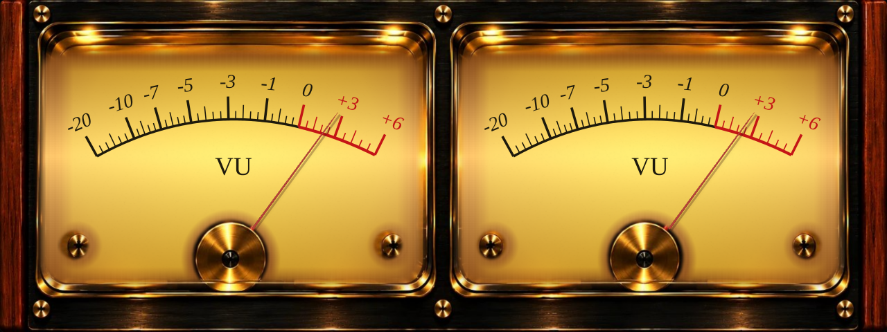
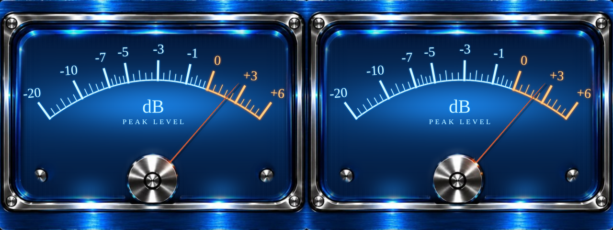
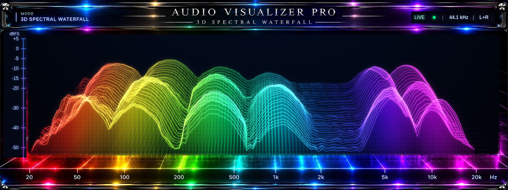

# AV PRO · Stereo Meters / 3D Spectral Waterfall

В проекте **три режима** по предоставленным фотографиям:

- **GOLD VU** — золотая рамка, деревянные боковины, тёплая освещённая шкала VU.
- **BLUE PEAK** — синий анодированный корпус, хром, холодная светящаяся шкала dB.
- **3D WATERFALL** — радужный спектральный водопад в хромированном корпусе:
  светящаяся поверхность, частотные гребни, вертикальные лучи и история в глубину.





## Запуск на Windows

1. Скачайте полный ZIP проекта на GitHub и распакуйте его.
2. Запустите `START_PROGRAM.bat`. Нужен установленный Edge или Chrome.
3. Выберите **3D WATERFALL**, чтобы открыть новый режим по фотографии.
4. Нажмите **FILE**, чтобы выбрать музыку, **DEMO** для проверки изображения,
   **MIC** для микрофона или **SYSTEM** для захвата звука вкладки / экрана.

Установка Node.js, npm и сборка EXE для браузерной версии не требуются.
Можно открыть `index.html` напрямую, если политика браузера это разрешает.
Для микрофона и звука вкладки рекомендуется localhost / HTTPS.

Если нужен локальный сервер, из папки проекта запустите:

```sh
python3 -m http.server 8000 --bind 127.0.0.1
```

В браузере откройте `http://localhost:8000`. Python нужен только для этого
необязательного способа запуска.

## Управление

- **GOLD / VU**, **BLUE / PEAK**, **3D / WATERFALL** — выбор прибора.
- **FILE** — воспроизведение аудиофайла по кругу и измерение его уровня.
- **MIC** — реальный микрофон / линейный вход; мониторинг в динамики выключен.
- **SYSTEM** — звук выбранной вкладки или экрана, если браузер и ОС его передают.
  В диалоге браузера нужно включить передачу звука.
- **DEMO** — измеряемый тестовый стереосигнал без воспроизведения в динамиках.
- **STOP** — освободить источник звука, вернуть стрелки к минимуму, очистить водопад.
- **HOLD** — заморозить изображение и историю; воспроизведение звука продолжается.
- **⛶** — полный экран.

Клавиши: **1 / 2 / 3** — прибор, **← / →** — переключение, **D** — демо,
**S** — захват системы, **F** — полный экран, **пробел** — HOLD,
**Esc** — отключить источник. Кнопки и элементы ввода сохраняют стандартное
управление с клавиатуры при фокусе.

## Изображение и объём

Фотографические панели из исходного проекта используются в пропорции **8:3**,
без растягивания. Шкалы, указатели и оси вращения работают в единой системе
координат 1280×480. На каждом канале только одна движущаяся стрелка;
фотографическая втулка перекрывает её основание.

Стрелки — настоящие объёмные призмы WebGL: красная эмаль, металлические фаски,
нормали поверхностей и освещение Cook–Torrance / GGX. Контактные тени показывают
расстояние от стрелки до шкалы. Отдельные оттенки подсветки воспроизводят
золотой и синий приборы. При недоступности WebGL или потере контекста
используется резервная Canvas-отрисовка с сохранением геометрии и анимации.

Материал внутренней шкалы восстанавливается при загрузке: мягкое рассеивание
света, мелкая неповторяющаяся фактура бумаги у Gold и горизонтальная
микрофактура металла у Blue. Корпус, винты, хром и втулки сохраняют
фотографическую детализацию. Статичная часть кэшируется, DPR ограничен 2.
Панель управления находится под прибором и не закрывает шкалы.

Водопад строит настоящую сетку WebGL по измеренным уровням: треугольная
поверхность с нормалями, полупрозрачные грани, светящиеся гребни и вертикальные
частотные линии. Перспективная проекция сжимает удалённые слои; отдельные
проходы свечения дают мягкий цветной ореол вокруг яркого ядра.
Корпус, винты и оптические блики взяты из соответствующей панели исходного
проекта. История содержит до 68 срезов с шагом 65 мс — примерно 4,4 секунды.
При смене источника она очищается, тишина не создаёт искусственные пики.
При недоступности WebGL сохраняется резервная Canvas-отрисовка той же истории.

## Измерение

Используется реальный PCM из Web Audio. Моно дублируется в два канала;
стереоканалы измеряются раздельно. Автоматическое усиление, эхокомпенсация
и шумоподавление запрашиваются выключенными; ОС может иметь свои обработки.

**Gold** показывает RMS с постоянной усреднения мощности 65 мс и механической
инерцией стрелки. **Blue** показывает sample peak с атакой 8 мс и возвратом
650 мс. Общая отметка **0** соответствует цифровому уровню **−18 dBFS**:
для Gold синус отнесён к RMS полноуровневой синусоиды, для Blue — к пику
цифрового отсчёта. Тон −18 dBFS устанавливается около 0 в обоих режимах.
Отклонения во времени не зависят от частоты кадров; полный динамический
отклик также включает механику стрелки.

**Waterfall** использует отдельную пару FFT-анализаторов 32768, 128
логарифмических полос 20 Гц–20 кГц и фактическую частоту дискретизации браузера.
Энергия каналов усредняется до перевода в dBFS; противоположные фазы не гасят
изображение. Мощность нормирована с учётом окна Blackman. Отображается
суммарный уровень каждой полосы, а не спектральная плотность мощности.
Атака — 35 мс, спад — 240 мс. Окно FFT добавляет около 0,68–0,74 с истории
отсчётов при 48/44,1 кГц; низкие частоты ограничены разрешением FFT.
Шкала высоты — от −55 до +5 dBFS, значения ниже скрыты на плоскости основания.
Индикатор LIVE и частота дискретизации показывают состояние действующего
источника. DEMO этого режима создаёт реальный широкополосный PCM с тонами,
шумом и ритмическими огибающими, измеряемый тем же FFT без звука в динамиках.

Это визуальная имитация приборов с описанной цифровой калибровкой,
без заявления о сертификации VU/PPM и без акустических SPL или аналоговых dBu.
Микрофон, системный loopback и поддерживаемые форматы файлов зависят от
браузера и устройства. Физический захват нужно разрешить и проверить на ПК.

## Разработка

```sh
npm run check
npm test
```

Для проверок нужен Node.js; тесты используют встроенный `node:test`,
установка npm-пакетов не требуется.

- `audio-engine.js` — источники, измерение стерео и времена отклика.
- `reference-meters.js` — фотографические панели, шкалы и механика.
- `needle-3d.js` — объёмные стрелки WebGL и восстановление контекста.
- `spectrum-engine.js` — калибровка FFT, логарифмические полосы и огибающие.
- `spectral-waterfall.js` — 3D-поверхность, история, свечение и резервная отрисовка.
- `app.js`, `index.html`, `styles.css` — управление и адаптивная компоновка.

Опциональная Electron-сборка: `npm install`, затем `npm run dist` для Windows
или `npm run dist:linux` для Linux. Она требует Electron / electron-builder.
Готовый EXE в исходный проект не включён.
