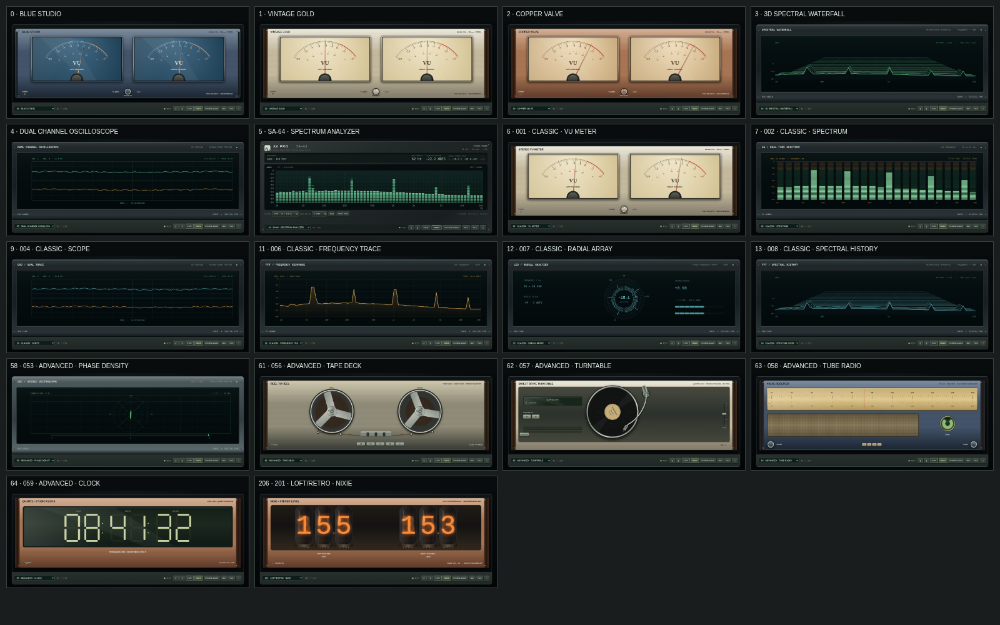

# Audio Visualizer Pro · Instrument Collection

Браузерный аудиовизуализатор с переработанным оформлением всех 256 режимов
и калиброванным спектроанализатором SA-64. При старте выбран SA-64, вход отключён.



## Запуск

Запустите страницу в современном Chrome / Edge / Firefox через локальный
HTTP-сервер (для микрофона и захвата вкладки нужны localhost или HTTPS):

```sh
cd /workspace/vu-meter
python3 -m http.server 8000 --bind 0.0.0.0
```

Откройте адрес локального сервера в браузере. Для браузерной версии
установка npm-пакетов не нужна. Прямое открытие `index.html` также возможно,
если политика вашего браузера разрешает локальные страницы; в облачном
Chromium доступ к file:// запрещён политикой, поэтому проверялся HTTP-запуск.
`START_PROGRAM.bat` из архива запускает страницу в окне Chrome / Edge на Windows.

- **FILE**: выбрать аудиофайл, воспроизвести и измерить его. Воспроизведение зациклено.
- **MIC**: микрофон без автоматического усиления, шумоподавления и эхокомпенсации.
  Звук микрофона в динамики не направляется.
- **SYSTEM AUDIO**: выбрать вкладку / экран со звуком и разрешить передачу аудио.
  Набор доступных источников зависит от браузера и ОС.
- **DEMO**: измерить настоящий тестовый PCM-сигнал без его воспроизведения.
- **STOP**: отключить вход и освободить микрофон / захват экрана.
- **HOLD**: заморозить экран; измерительный тракт продолжает работать.
- **RESET PEAK**: сбросить удержанные пики, сохранив текущие уровни.
- **FAST / SLOW**: постоянные времени атаки / возврата 35 / 320 мс и 100 / 1000 мс.
- **ВЕРХ ШКАЛЫ**: 0, −20 или −40 dBFS, диапазон экрана всегда 90 dB.

Клавиши: ← / → — режим, PgUp / PgDn — ±10 режимов, Home — первый режим,
D — тестовый сигнал, S — захват звука, F — полный экран, пробел — HOLD SA-64.
При фокусе в кнопке или списке действуют стандартные клавиши этого элемента.

## Оформления приборов

Все 256 режимов используют новые отрисовки. В коллекции сохранены 6 основных
приборов и 250 вариантов отделки на основе 12 типов визуализации:

- **Blue Studio / Vintage Gold / Copper Valve**: пропорциональные шкалы,
  стрелки из общей оси, согласованные отметки, металлические ободки,
  утопленная бумажная или синяя шкала, стекло и деревянные боковины.
- **Электронные экраны**: зелёный / янтарный / голубой люминофор,
  сегменты индикаторов, координатная сетка, след и затухающее послесвечение.
  У осциллографа развёртка рассчитывается из реальной частоты дискретизации.
- **Катушечник и проигрыватель**: намотка ленты, металлические спицы,
  направляющие и головки, дорожки винила, тонарм и картридж.
  Вращение связано с активным источником; STOP останавливает его на текущем угле.
- **Лампы, радио, часы**: сетки и катоды индикаторов Nixie, стеклянные колбы,
  радиошкала и ткань динамика, индикатор «магический глаз», стрелочные
  и сегментные часы. Радиошкала — элемент оформления, а не FM-приёмник.
- **Частотная история и фазовые режимы**: трёхмерный водопад, сонограмма,
  XY-развёртка, векторное облако и круговой частотный индикатор.
  Они получают измеренные аудиоданные; случайные частицы и автоматическое
  вращение цветовой схемы убраны.

Корпуса имеют фиксированные варианты отделки: графит, титан, светлый металл,
медь и дерево. Панель выбора режима и источника всегда находится ниже
прибора, не перекрывая шкалу. Адаптивная геометрия заменяет растянутые
фотографии с неподвижными подписями и стрелками.
Ручки и клавиши, нарисованные на корпусах, — часть оформления;
управление программой находится на нижней панели.

## Измерительный тракт SA-64

- Корпус под металлический лабораторный прибор, утопленный дисплей,
  сегментные зелёные / жёлтые / красные индикаторы и отдельные пиковые метки.
- 64 полосы по логарифмической оси от 20 Гц до 20 кГц
  (верхняя частота ограничивается Найквистом при низкой частоте дискретизации).
- FFT 32768 с окном Blackman. Частота дискретизации берётся из AudioContext,
  а не предполагается равной 48 кГц. Шаг FFT отображается на панели.
- Мощности левого и правого каналов усредняются в линейном масштабе.
  Затем интегрируются по полосам с дробными весами пограничных FFT-бинов.
  Полосы не дублируют энергию общих бинов. Противофазные каналы не гасят спектр.
- Поправка на энергию окна: сумма мощностей полос для полноуровневого синуса
  равна 1 (0 dBFS, отнесённых к полноуровневой синусоиде).
  Если тон расположен на границе полос, его энергия распределится между ними.
- Усреднение мощности и спад пиков зависят от прошедшего времени:
  удержание 1 с, последующий спад 18 dB/с. Дополнительной степени,
  случайных столбцов и автоматического подбора масштаба нет.
- Числовые показания частоты — **центр самой мощной полосы**, а не точное
  определение частоты тона. Показания L/R — sample peak в dBFS,
  с визуальным возвратом 24 dB/с; это не true-peak / intersample meter.
  CLIP загорается на 1 с при отсчётах с модулем ≥ 0.999.
- Моно корректно дублируется в оба канала. При смене входа очищается история
  измерений, при отключении дорожек освобождается источник.
- Осциллограф теперь использует фиксированный масштаб ±1.0;
  автоматическое усиление с прежними неподвижными подписями удалено.

Стрелочные режимы построены с номинальным уровнем 0 VU = −18 dBFS
(полноуровневая синусоида) и сглаживанием уровня. Это имитация стрелочной
механики, без заявления о соответствии стандарту VU. Дополнительные
250 оформлений используют общие аудиоданные и собственную визуальную динамику;
калибровка мощности полос, описанная здесь, относится к **SA-64**, режиму 06 / 256.

## Пределы измерения

Это цифровой невзвешенный анализатор dBFS, без акустической калибровки SPL,
аналоговых единиц dBu/dBV и сертификации измерительного прибора.
На 48 кГц окно FFT длится около 683 мс, шаг бинов 1.465 Гц,
эквивалентная шумовая полоса окна около 2.53 Гц, главный лепесток около 8.79 Гц.
На низких частотах соседние узкие полосы поэтому коррелированы.
Увеличение количества полос не повышает физическое разрешение.
Отображение до −130 dBFS при смещении шкалы не означает такую точность АЦП.

Столбцы показывают **мощность в полосе**, а не плотность спектра на герц.
Белый шум на логарифмической шкале поэтому растёт к высоким частотам.
Микрофон и системный тракт могут дополнительно обрабатывать звук средствами ОС.

## Проверки

```sh
npm run check
npm test
```

Тесты запускаются встроенным `node:test`, без установки зависимостей.
Проверяются синусы на / между FFT-бинами, 44.1 / 48 / 96 кГц,
масштаб −6 dB, мощностное сложение стерео, тишина, границы полос,
времена усреднения, удержание пиков и сброс состояния.

В Chromium дополнительно проверены WAV-файлы с тонами 1 кГц / 3 кГц,
моно / стерео, переподключение файлов и DEMO. Все 256 режимов проверены
на непустую отрисовку и расположение панели управления. Представители всех
12 семейств проверены при 390×844, 800×480, 1920×480 и 1440×900.
Вращение катушек и винила проверено при активном источнике и после STOP.
Шесть механических семейств прошли 192 проверки комбинаций тем и размеров.
Физический микрофон и системный loopback требуют разрешения пользователя
и проверки на его устройстве.

Опциональная Electron-сборка остаётся в `package.json`. Для неё нужны
Electron и electron-builder; создание EXE / AppImage в этой задаче не выполнялось.
