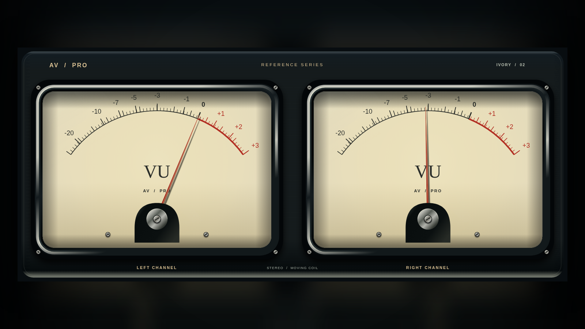
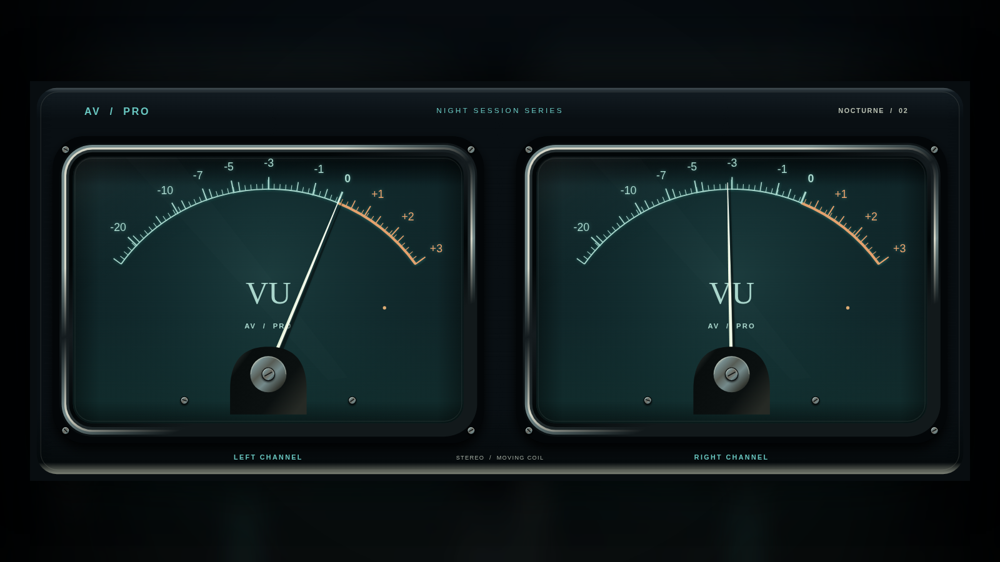
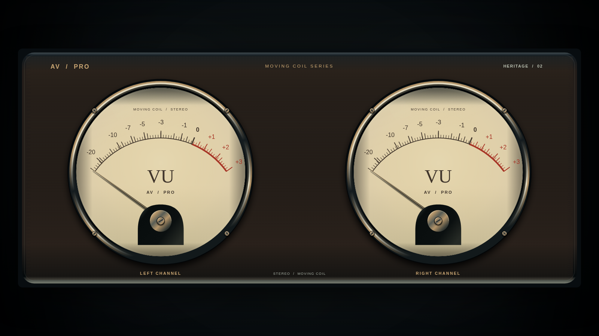
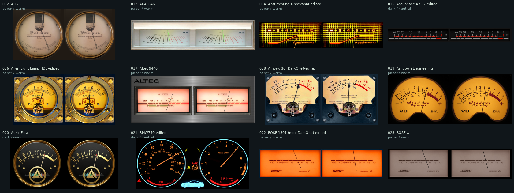
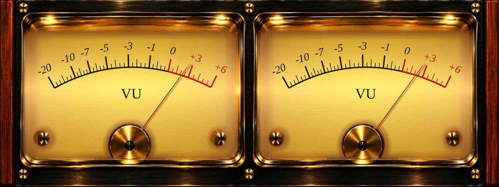
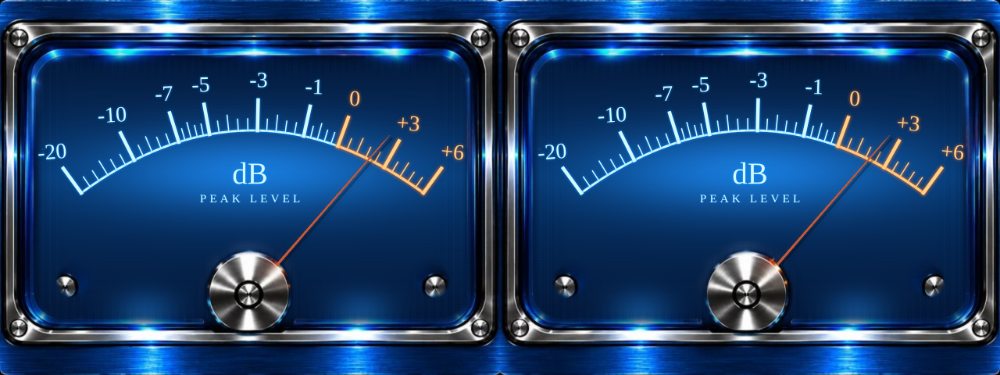
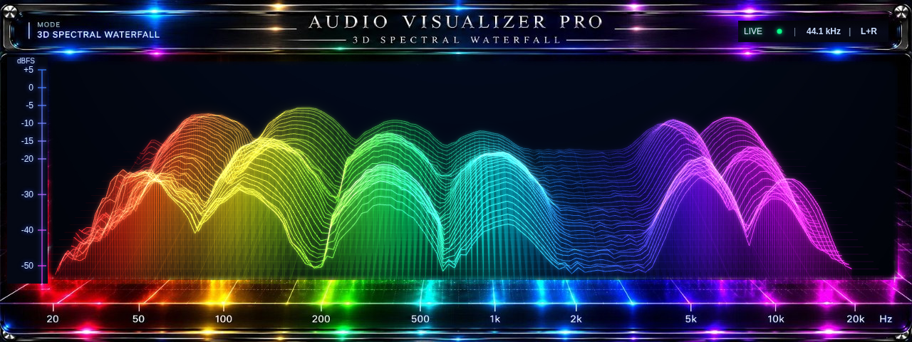
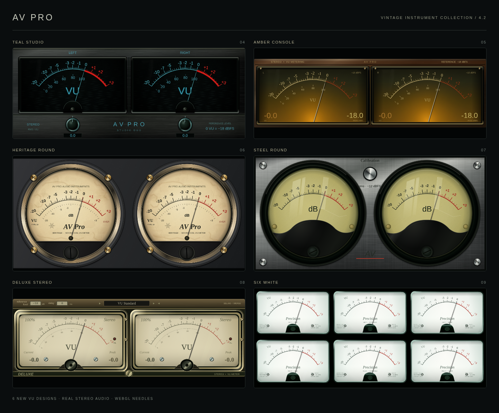

# Скачать полную программу 4.3.1 для Windows

**Родной Spectral Waterfall + 19 новых визуализаций + все 123 BIN-скина.**

## [Скачать готовую программу ZIP — 525 МБ](https://github.com/cristalix81/vu-meter/raw/refs/heads/main/releases/AudioVisualizerPro-Desktop-VU-4.3.1.zip)

Это полный выпуск на основе **вашего исходного архива 4.3.0**, с EXE,
библиотеками и всей коллекцией BIN. Четыре встроенных стрелочных режима
Atelier убраны. Другие возможности исходной программы сохранены.

Распакуйте **всю папку** и запустите **Audio Visualizer Pro.exe**.

**Выбор десяти скинов:** откройте каталог → в строке «Автосмена» нажмите
«Снять все» → отметьте «В автосмену» у нужных приборов → включите автосмену.
Галочки сохраняются после перезапуска. Всего доступно **143 позиции**.

[Инструкция и список изменений](releases/README-4.3.1.md) ·
[Отчёт проверок](releases/VALIDATION-4.3.1.json) ·
[SHA-256](releases/SHA256SUMS-4.3.1.txt)

154 автоматических теста прошли; итоговый app.asar также проверен запуском.
Все 123 BIN, исходный Windows EXE и Electron 37.10.3 сохранены побайтно.
Интерактивные проверки выполнены в Linux Electron 45; реальная работа
этого выпуска на Windows с аудиоустройствами пока не проверена.

Ниже сохранены предыдущие публикации.

---

# Скачать Spectral Gallery 4.5.0 для Windows

**19 живых оформлений без стрелок.**

- **[Полная программа ZIP — 199 МБ](https://github.com/cristalix81/vu-meter/raw/refs/heads/main/releases/AudioVisualizerPro-Spectral-4.5.0.zip)**
- [Установщик Windows x64 — 199 МБ](https://github.com/cristalix81/vu-meter/raw/refs/heads/main/releases/AudioVisualizerPro-Spectral-Setup-4.5.0-x64.exe)
- [Инструкция и сведения о проверках](releases/README-Spectral-4.5.0.md)

Распакуйте всю папку и запустите `Audio Visualizer Pro.exe`. Предыдущая версия не требуется. Windows EXE пока не проверен на настоящем Windows-компьютере; сборка не подписана.

Ниже сохранена документация предыдущих версий.

---

# Настольный VU-meter 4.3.0 · ATELIER

Четыре оригинальных прибора: IVORY, PLATINUM, NOCTURNE и HERITAGE.
Послойные корпуса и стекло, векторные шкалы, отдельные непрерывные стрелки
с тенями, настройка света и отражений. Для всех 123 BIN-скинов добавлено
адаптивное оформление стекла, света и корпуса, качественное масштабирование
и отдельные настройки каждого скина. Сохранены непрерывное измерение PCM,
раздельные VU/PPM, калибровка BIN, вход, монитор, профили и макропульт.
**Исходники и инструкция:** [desktop](desktop/README_4.3.0_RU.md).

- **[Полная готовая программа 4.3.0 — ZIP](https://github.com/cristalix81/vu-meter/raw/main/releases/AudioVisualizerPro-Desktop-VU-4.3.0.zip)**:
  EXE, необходимые библиотеки, четыре авторских прибора и все 123 BIN-скина. Распакуйте и запустите
  `Audio Visualizer Pro.exe`. Предыдущая версия не требуется.
- [Отдельный архив исходников 4.3.0](releases/AudioVisualizerPro-Source-4.3.0.zip).
- [Отчёт проверок 4.3.0](desktop/audit/validation-4.3.0.json): 108 Node-тестов,
  все 123 BIN в пяти положениях, проверки профилей, оформления и 4K.
- [Предыдущая полная версия 4.2.41](https://github.com/cristalix81/vu-meter/raw/main/releases/AudioVisualizerPro-Desktop-VU-4.2.41.zip).

Полный ZIP хранится через Git LFS. Коллекция BIN входит в этот ZIP.
Программа не подписана; реальные аудиоустройства, сон, несколько мониторов
и установку/удаление нужно дополнительно проверить на Windows 10/11.






[Сравнение исходных и улучшенных BIN-скинов](desktop/audit/bin-before-after.png).

Ниже сохранена документация отдельной, ранее созданной браузерной версии.

# AV PRO · Reference Instrument Collection

В проекте **девять режимов**, включая шесть новых приборов по предоставленным
изображениям:

- **GOLD VU** — золотая рамка, деревянные боковины, тёплая освещённая шкала VU.
- **BLUE PEAK** — синий анодированный корпус, хром, холодная светящаяся шкала dB.
- **3D WATERFALL** — радужный спектральный водопад в хромированном корпусе:
  светящаяся поверхность, частотные гребни, вертикальные лучи и история в глубину.
- **TEAL STUDIO** — тёмная студийная панель, бирюзовые шкалы, красный перегруз.
- **AMBER CONSOLE** — узкий стереоприбор с янтарным светом и цифровыми показаниями.
- **HERITAGE ROUND** — бронзовые ободки, состаренная бумага и тонкие чёрные стрелки.
- **STEEL ROUND** — круглый бакелит, стальная панель и отражения в выпуклом стекле.
- **DELUXE STEREO** — кремовые шкалы в многослойной латунной рамке.
- **SIX WHITE** — шесть белых приборов: слева FAST, в центре STANDARD, справа SLOW;
  верхний ряд показывает левый канал, нижний — правый.






## Запуск на Windows

1. Скачайте полный ZIP проекта на GitHub и распакуйте его.
2. Запустите `START_PROGRAM.bat`. Нужен установленный Edge или Chrome.
3. Выберите прибор на панели режимов. Шесть новых оформлений — кнопки **TEAL**,
   **AMBER**, **HERITAGE**, **STEEL**, **DELUXE** и **SIX**.
4. Нажмите **FILE**, чтобы выбрать музыку, **DEMO** для проверки изображения,
   **MIC** для микрофона или **SYSTEM** для захвата звука вкладки / экрана.

Установка Node.js, npm и сборка EXE для браузерной версии не требуются.
Можно открыть `index.html` напрямую, если политика браузера это разрешает.
Для микрофона и звука вкладки рекомендуется localhost / HTTPS.

Если нужен локальный сервер, из папки проекта запустите:

```sh
python3 -m http.server 8000 --bind 127.0.0.1
```

В браузере откройте `http://localhost:8000`. Python нужен только для этого
необязательного способа запуска.

## Управление

- Панель из **девяти кнопок** — выбор прибора; управление расположено под шкалами.
- **FILE** — воспроизведение аудиофайла по кругу и измерение его уровня.
- **MIC** — реальный микрофон / линейный вход; мониторинг в динамики выключен.
- **SYSTEM** — звук выбранной вкладки или экрана, если браузер и ОС его передают.
  В диалоге браузера нужно включить передачу звука.
- **DEMO** — измеряемый тестовый стереосигнал без воспроизведения в динамиках.
- **STOP** — освободить источник звука, вернуть стрелки к минимуму, очистить водопад.
- **HOLD** — заморозить изображение и историю; воспроизведение звука продолжается.
- **⛶** — полный экран.

Клавиши: **1–9** — прибор по порядку кнопок, **← / →** — переключение, **D** — демо,
**S** — захват системы, **F** — полный экран, **пробел** — HOLD,
**Esc** — отключить источник. Кнопки и элементы ввода сохраняют стандартное
управление с клавиатуры при фокусе.

## Изображение и объём

Исходные Gold, Blue и Waterfall сохраняют пропорцию **8:3**. Новые панели
имеют собственные пропорции по образцам: круглый прибор остаётся круглым,
узкая консоль — узкой. Шкалы и стрелки используют одну систему координат
каждой панели; нижние механизмы и втулки перекрывают основания указателей.

Стрелки — настоящие объёмные призмы WebGL: эмаль, металлические фаски,
нормали поверхностей и освещение Cook–Torrance / GGX. Контактные тени показывают
расстояние от стрелки до шкалы. Отдельные оттенки подсветки воспроизводят
золотой и синий приборы. При недоступности WebGL или потере контекста
используется резервная Canvas-отрисовка с сохранением геометрии и анимации.

Материал внутренней шкалы восстанавливается при загрузке: мягкое рассеивание
света, мелкая неповторяющаяся фактура бумаги у Gold и горизонтальная
микрофактура металла у Blue. Корпус, винты, хром и втулки сохраняют
фотографическую детализацию. Статичная часть кэшируется, DPR ограничен 2.
Панель управления находится под прибором и не закрывает шкалы.

Шесть новых панелей нарисованы программно по композиции образцов: шлифованный
металл, кольцевые блики на ободках, винты с фасками, бумажная микрофактура,
следы влаги и тонкие трещины у Heritage. Стекло лежит перед движущимися
стрелками; отражения и тени показывают глубину. Бирюзовые, чёрные и светлые
стрелки имеют разные материалы. Это воссозданные оформления, а не точные
копии интерфейсов или логотипов сторонних плагинов.

Водопад строит настоящую сетку WebGL по измеренным уровням: треугольная
поверхность с нормалями, полупрозрачные грани, светящиеся гребни и вертикальные
частотные линии. Перспективная проекция сжимает удалённые слои; отдельные
проходы свечения дают мягкий цветной ореол вокруг яркого ядра.
Корпус, винты и оптические блики взяты из соответствующей панели исходного
проекта. История содержит до 68 срезов с шагом 65 мс — примерно 4,4 секунды.
При смене источника она очищается, тишина не создаёт искусственные пики.
При недоступности WebGL сохраняется резервная Canvas-отрисовка той же истории.

## Измерение

Используется реальный PCM из Web Audio. Моно дублируется в два канала;
стереоканалы измеряются раздельно. Автоматическое усиление, эхокомпенсация
и шумоподавление запрашиваются выключенными; ОС может иметь свои обработки.

**Gold** показывает RMS с постоянной усреднения мощности 65 мс и механической
инерцией стрелки. **Blue** показывает sample peak с атакой 8 мс и возвратом
650 мс. Общая отметка **0** соответствует цифровому уровню **−18 dBFS**:
для Gold синус отнесён к RMS полноуровневой синусоиды, для Blue — к пику
цифрового отсчёта. Тон −18 dBFS устанавливается около 0 в обоих режимах.
Отклонения во времени не зависят от частоты кадров; полный динамический
отклик также включает механику стрелки.

Шесть новых VU-панелей используют тот же RMS-детектор. **0 VU = −18 dBFS**
для Teal, Amber, Heritage, Deluxe и Six; **0 VU = −12 dBFS** для Steel,
что указано на панели. Здесь dBFS относится к амплитуде тестового синуса;
RMS нормирован к RMS полноуровневого синуса. Цифры Amber и Deluxe показывают
реальный текущий RMS и peak, тишина отображается как −∞.
Six повторяет два реальных канала в трёх парах с различной механической
инерцией. Входных каналов остаётся два; дополнительных сигналов не создаётся.
Ручки и винты внутри нарисованных корпусов — детали оформления;
доступные действия находятся на отдельной панели управления.

**Waterfall** использует отдельную пару FFT-анализаторов 32768, 128
логарифмических полос 20 Гц–20 кГц и фактическую частоту дискретизации браузера.
Энергия каналов усредняется до перевода в dBFS; противоположные фазы не гасят
изображение. Мощность нормирована с учётом окна Blackman. Отображается
суммарный уровень каждой полосы, а не спектральная плотность мощности.
Атака — 35 мс, спад — 240 мс. Окно FFT добавляет около 0,68–0,74 с истории
отсчётов при 48/44,1 кГц; низкие частоты ограничены разрешением FFT.
Шкала высоты — от −55 до +5 dBFS, значения ниже скрыты на плоскости основания.
Индикатор LIVE и частота дискретизации показывают состояние действующего
источника. DEMO этого режима создаёт реальный широкополосный PCM с тонами,
шумом и ритмическими огибающими, измеряемый тем же FFT без звука в динамиках.

Это визуальная имитация приборов с описанной цифровой калибровкой,
без заявления о сертификации VU/PPM и без акустических SPL или аналоговых dBu.
Микрофон, системный loopback и поддерживаемые форматы файлов зависят от
браузера и устройства. Физический захват нужно разрешить и проверить на ПК.

## Разработка

```sh
npm run check
npm test
```

Для проверок нужен Node.js; тесты используют встроенный `node:test`,
установка npm-пакетов не требуется.

- `audio-engine.js` — источники, измерение стерео и времена отклика.
- `reference-meters.js` — фотографические панели, шкалы и механика.
- `needle-3d.js` — объёмные стрелки WebGL и восстановление контекста.
- `vintage-kit.js` — материалы, шкалы, крепёж и стекло новых панелей.
- `vintage-dark.js`, `vintage-round.js`, `vintage-classic.js` — шесть оформлений.
- `vintage-meters.js` — их калибровка, механика и отрисовка стрелок.
- `spectrum-engine.js` — калибровка FFT, логарифмические полосы и огибающие.
- `spectral-waterfall.js` — 3D-поверхность, история, свечение и резервная отрисовка.
- `app.js`, `index.html`, `styles.css` — управление и адаптивная компоновка.

Опциональная Electron-сборка: `npm install`, затем `npm run dist` для Windows
или `npm run dist:linux` для Linux. Она требует Electron / electron-builder.
Готовый EXE в исходный проект не включён.
