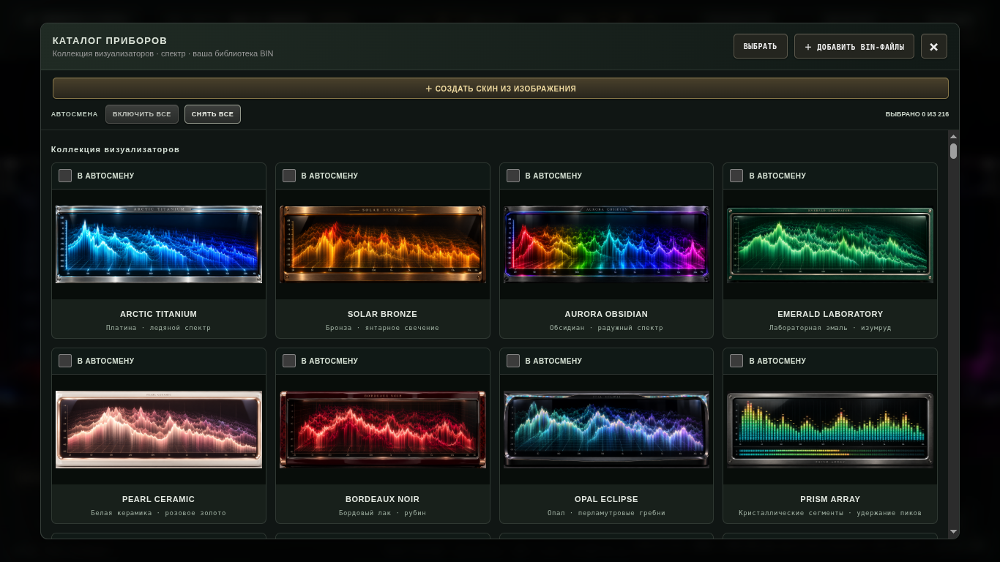

# Audio Visualizer Pro 4.3.2

**[Скачать полную программу ZIP — около 525 МБ](https://github.com/cristalix81/vu-meter/raw/refs/heads/main/releases/AudioVisualizerPro-Desktop-VU-4.3.2.zip)**

Закройте предыдущую версию. Распакуйте всю папку из архива и запустите
**Audio Visualizer Pro.exe** из папки **4.3.2**. Это полная программа для
Windows x64 с EXE, библиотеками, ресурсами и всеми 123 BIN-скинами.
Предыдущая версия, Node.js и Python для запуска не нужны.

## Исправлены галочки

В 4.3.1 фиксированная высота строк каталога обрезала нижнюю часть карточек.
Теперь строка **«В АВТОСМЕНУ»** с крупным квадратом находится **над картинкой**
каждого скина. Высота карточек подстраивается под содержимое. Исправлена и
пустая высокая строка между заголовком группы и картинками.

Чтобы оставить десять скинов: откройте каталог → **«СНЯТЬ ВСЕ»** → отметьте
нужные скины в строках **«В АВТОСМЕНУ»** → закройте каталог → включите
автосмену. Можно нажимать на квадрат или на всю строку. Выбор сохраняется;
ручной выбор скина и инструменты удаления BIN работают отдельно.

## Ускорены новые скины

- Новые водопады используют тот же темп анализа и реальное прошедшее время,
  что исходный waterfall. Долгий кадр больше не растягивает историю во времени.
- Неизменившиеся кадры водопада используют готовое изображение с тем же
  свечением. В контрольном сравнении число операций изображения совпало
  с исходным водопадом: 120 вместо прежних 960 за 240 вызовов.
- Спектр, стереоканалы и PCM не пересчитываются повторно для одного пакета.
- Сегменты PRISM, осциллограммы, свечение HALO и поверхности мембран
  используют повторно готовые элементы. HALO рисует кольцо напрямую на
  медленных кадрах, чтобы промежуточная поверхность не добавляла нагрузку.
- Сохранены изображения корпусов и детализация. Кеши учитывают масштаб
  экрана; исходный код и корпус родного waterfall не менялись.

Это проверенные изменения вычислений и отрисовки, а не обещание одинакового
FPS на любом компьютере. Замеры выполнялись в Linux Electron 45 с программным
WebGL и ограничением четырёх ядер. Для этой среды зафиксированы сокращение
повторных операций и улучшения отдельных режимов; устойчивое общее ускорение
в FPS и снижение загрузки CPU для всех режимов этими замерами не подтверждены.

## Сохранено

Все 19 новых визуализаций, исходный waterfall, все 123 исходных BIN и их
миниатюры — **143 позиции в комплекте**, плюс ваши импортированные скины.
Не менялись исходный Windows EXE, Electron 37.10.3, DLL, BIN-файлы,
калибровка приборов, выбор входа, профили и макропульт.

## Проверки

Все **172 автоматических теста** прошли. Проверено реальное расположение
216 карточек в каталоге при 800×480, 1366×768 и 1920×480: квадраты находятся
внутри карточек; естественное нажатие мышью меняет выбор, не закрывая каталог.
Проверяются также итоговый app.asar, выбор десяти скинов, профили, STOP и
живой сигнал. [Подробный отчёт](VALIDATION-4.3.2.json).

Все 211 файлов исходного пакета 4.3.0 вне app.asar сохранены побайтно.
Текущий манифест в папке программы — **RELEASE_MANIFEST_4.3.2.json**.
Старые документы и отчёты 4.3.0 относятся к предыдущему выпуску.

Комплект Windows использует исходный Electron **37.10.3**. На физическом
Windows-компьютере этот выпуск не запускался; аудиодрайверы, сон,
несколько мониторов и DPI требуют отдельной проверки на Windows.
Новая цифровая подпись или установщик не добавлены.

[Контрольная сумма ZIP](SHA256SUMS-4.3.2.txt). Большой файл хранится в Git LFS;
скачивайте программу по ссылке выше, а не через **Code → Download ZIP**.
